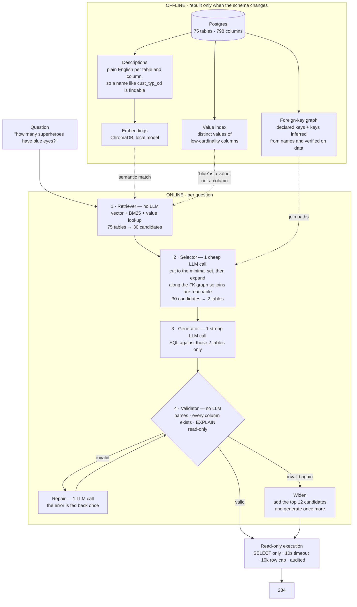

# Selective-Schema Text-to-SQL

A text-to-SQL system that **does not paste the whole database schema into the
prompt**. It indexes the schema offline, retrieves only the tables and columns
relevant to each question, and generates SQL against that small subset.

## Why

On large databases, putting the full schema in the prompt is the bottleneck:

- **Cost:** every question pays for thousands of schema tokens.
- **Context limits:** real warehouses don't fit.
- **Accuracy:** too much schema makes the model pick the wrong table.

Selective retrieval should beat full-schema prompting on all three. This is a
known research area (schema linking, database context compression; see e.g.
CHESS, CRUSH4SQL, and the counter-argument "The Death of Schema Linking?").
The goal here isn't novelty. It's a working implementation, **measured
honestly** against a strong full-schema baseline.

## Results

Measured on [BIRD Mini-Dev](https://github.com/bird-bench/mini_dev) (PostgreSQL):
**11 databases, 75 tables, 798 columns, 3.9M rows**. Frozen 50-question sample,
no evidence hints, `gpt-oss-120b` generator, `gpt-oss-20b` selector, Groq free
tier. EX is execution accuracy: the query runs and returns the same rows as the
reference answer. Each row is one run; read the variance note before comparing
two rows.

| Strategy | Tables visible | EX | Input tokens / question | Cost / question | p50 latency |
|---|---|---|---|---|---|
| Full schema (baseline) | own database | 50% | 2,219 | $0.00052 | 1.3s |
| Selective | own database | 46% | 1,425 | $0.00040 | 1.8s |
| Selective + validation | own database | 50% | 1,455 | $0.00039 | 1.8s |
| Selective | all 75 | 46% | 2,021 | $0.00043 | 1.7s |

- **Variance is the headline caveat.** The baseline was run twice with
  byte-identical prompts at temperature 0: 50% and 46%, with 4 questions flipping
  (1 fixed, 3 broken). So roughly 4 points of EX is run-to-run noise, and none of
  the accuracy gaps in the table above are significant on 50 questions. The token
  and cost numbers are stable: both runs averaged exactly 2,219 input tokens.
- **The token saving is the real result:** selective matches the baseline's
  accuracy band at 34% fewer input tokens and 25% lower cost.
- **All 75 tables visible:** selective holds the same accuracy band with every
  table in the corpus as a candidate (46%, 2 questions fixed and 2 broken). The
  full-schema prompt there is 8.2K-21.8K tokens, over the free tier's 8K request
  limit, so the baseline cannot run at all. This is the case selective retrieval
  exists for.
- **A recall-first selector did not pay for itself.** Also keeping the
  retriever's top 4 tables includes the needed tables 98% of the time (vs 82%),
  but costs 57% more tokens and scored 44%, so it buys no measurable accuracy
  with the saving spent. It stays opt-in (`selective_recall`).
- The retriever finds 99.3% of needed tables in its top 30 (all 498 questions,
  all 75 tables visible).
- The repair step ran once in 50 questions and did not change the answer.

Run summaries are in `runs/*/summary.json`. Cost is at Groq list prices; the
actual spend was $0.

## How it works

The schema is indexed once, offline. Each question then walks a short pipeline
where only two steps call a model.



That is the real trace for that question: 75 tables went in, 2 reached the
prompt, 2 model calls were made, and the answer was correct. The retriever and
validator use no model at all — retrieval is vectors and keywords, join
resolution is graph traversal, validation is a parser and `EXPLAIN`. A question
therefore costs two LLM calls, three if a repair is needed, and four in the
worst case where the schema is widened.

## Local setup

**Requirements:** Docker, [uv](https://docs.astral.sh/uv/), ~4 GB free disk.

### 1. Secrets

Create a `.env` in the repo root. It is gitignored; never commit it.

```sh
cat > .env <<EOF
POSTGRES_ADMIN_PASSWORD=$(openssl rand -hex 16)
SQLAGENT_RO_PASSWORD=$(openssl rand -hex 16)
EOF
```

### 2. Postgres and the BIRD data

```sh
mkdir -p data && curl -o data/minidev.zip https://bird-bench.oss-cn-beijing.aliyuncs.com/minidev.zip
unzip -q data/minidev.zip -d data

docker compose up -d --wait

docker compose exec -T postgres bash -c \
  "sed '/ OWNER TO xiaolongli;\$/d' /data/minidev/MINIDEV_postgresql/BIRD_dev.sql \
   | psql -q -U postgres -d bird -v ON_ERROR_STOP=1 --single-transaction"

uv sync
uv run python scripts/map_tables.py
```

### 3. Read-only role

```sh
scripts/apply_roles.sh
```

### 4. Tests

```sh
uv run pytest
uv run ruff check && uv run ruff format --check
```

Database tests skip when Postgres isn't reachable locally. In CI they fail instead.

### 5. Evaluation

The 50-question sample (`eval/sample_50.json`) is committed and frozen. Build the
gold result cache once, then run a strategy:

```sh
uv run python scripts/cache_gold.py
uv run python scripts/run_eval.py gold_oracle
uv run python scripts/run_eval.py full_schema --limit 3
uv run python scripts/run_eval.py full_schema
```

`full_schema` is the baseline: each question's own database as `CREATE TABLE`
DDL with keys and 3 sample rows, sent to `openai/gpt-oss-120b` on Groq
(`reasoning_effort=medium`, temperature 0, no evidence hints). It needs
`GROQ_API_KEY` in `.env`. It runs within the Groq free tier: requests are paced
to the per-minute token limit, and a run stops with `QuotaExhausted` rather than
waiting out the daily limit. A full 50-question run uses about 150K tokens, so
plan one per day. Use `--limit` for smoke tests.

Strategies: `gold_oracle` (harness check), `full_schema` (baseline), `selective`,
`selective_validated`, `selective_pooled` (all 75 tables visible) and
`selective_recall` (recall-first selector).

Each run writes three files to `runs/<timestamp>_<strategy>/`:

- `config.json`: git SHA, sample hash, question ids, price table
- `results.jsonl`: one row per question with SQL, correctness, errors, tokens, latency, cost
- `summary.json`: EX overall and by difficulty, errors by type, tokens, p50/p95 latency, cost

Only `summary.json` is committed. `gold_oracle` returns the gold SQL; it must score 100% EX, which
checks the harness itself.

Compare two runs question by question. Repeating one identical run flipped 4
questions, so read the fixed and broken lists, not just the EX delta:

```sh
uv run python scripts/compare.py runs/<run_a> runs/<run_b>
```

A run stopped by the free-tier daily limit is marked incomplete; continue it the
next day instead of starting over (it refuses if the strategy, its settings or
the questions changed):

```sh
uv run python scripts/run_eval.py selective_pooled --resume runs/<run>
```

The Results table above is generated from run summaries, not typed by hand:

```sh
uv run python scripts/results_table.py runs/<run_a> runs/<run_b> ...
```

## Offline index

Built once per schema, used by the retriever. No LLM at query time.

```sh
uv run python scripts/describe_schema.py
uv run python scripts/build_index.py
```

`describe_schema.py` writes one table and column description per table with
`gpt-oss-20b`. It is resumable: re-running skips tables whose schema is
unchanged, so a run interrupted by the free-tier daily limit continues the next
day. `build_index.py` then builds everything else and refuses to run while any
table is undescribed:

| Part | What it holds | LLM |
|---|---|---|
| `fk_graph.json` | declared foreign keys plus keys inferred from names and verified against the data | no |
| `values.json` | distinct values of low-cardinality text columns, for keyword lookup | no |
| `descriptions.json` | table and column descriptions, with per-table token cost | yes, offline |
| `chroma/` | embeddings of one document per table and per column (fastembed `bge-small-en-v1.5`, local) | no |
| `manifest.json` | counts, per-part content hashes, a combined content hash, and the offline token cost | — |

Everything lands in `data/index/`, which is gitignored. Descriptions and sampled
values are treated as untrusted text: they are generated from database content
and end up in prompts.

## API

```sh
uv run uvicorn sqlagent.api.app:app --port 8000
curl -s localhost:8000/health
curl -s localhost:8000/ask -H 'content-type: application/json' \
  -d '{"question": "how many superheroes have blue eyes?"}'
```

`POST /ask` runs retrieve → select → generate → validate → repair and returns
the SQL, up to 100 result rows, and the per-stage trace (calls, tokens,
latency, which rung was reached). The offline index must be built first, and
`GROQ_API_KEY` must be set. Results come back through the same read-only,
audited query path as everything else. There is no authentication: run it
locally, not on a public address.

## Web app

A chat-style Next.js + TypeScript app in `web/`. Each answer plays a short
animated diagram of how it was found: the tables searched, the ones chosen,
the join between them with the columns the query read, then the result. Rows
follow as a table, with the SQL and timings in expandable sections. Past questions are kept
in the sidebar (stored in your browser), and the database can be narrowed from
the sidebar. Enter sends, Shift+Enter adds a line. Light and dark themes follow
the system setting.

```sh
uv run uvicorn sqlagent.api.app:app --port 8000
cd web && npm install && npm run dev
```

The browser only talks to the Next.js server; its `/api/*` routes forward to
the FastAPI backend at `BACKEND_URL` (default `http://127.0.0.1:8000`), so the
backend address never reaches the client. Checks: `npm run lint`,
`npm run typecheck`, `npm test`, `npm run build`.

## Security model

All generated SQL is treated as untrusted. The controls sit in the database, not
in the prompt.

- **Read-only role `sqlagent_ro`:** CONNECT on `bird` only, SELECT on the
  allowlisted schema only, no sequence privileges. Privileges are the real
  control; `default_transaction_read_only` is a second layer.
- **Default-Postgres bypasses closed:** large-object writes, `set_config` from
  inside a SELECT, DO blocks, TEMP tables, and CONNECT to other databases.
- **Resource limits:** 10s statement timeout, 30s idle-in-transaction timeout,
  100 MB temp files.
- **Known gaps Postgres cannot close:** a bare `SET statement_timeout`, and a role
  changing its own defaults. Tests pin both; `db.execute` closes them.
- **Single query path, `sqlagent.db.execute`:**
  - SQLGlot accepts exactly one read-only query. It rejects DML hidden in CTEs,
    `SELECT INTO`, `FOR UPDATE`, `SET`, `COPY`, and multiple statements.
  - Each call runs in a `READ ONLY` transaction with its own `statement_timeout`.
  - Results come through a server-side cursor (which also rejects multi-statement
    input at the protocol level), capped at 10,000 rows with a `truncated` flag.
  - Every call, including rejected ones, is appended to `audit/queries.jsonl`.
- **Untrusted prompt data:** sample values are sanitised (whitespace collapsed,
  comment and tag delimiters escaped, truncated) and wrapped in `<schema>` tags
  that the model is told to treat as data. Whatever the model returns still has
  to pass `db.execute`.

- **API and web app:** errors returned to clients are generic; details go to
  the server log only. The web routes cap request bodies at 16 KB and send
  `nosniff`, `frame-ancestors 'none'` and `no-referrer` headers.
- **Accepted risks:** the API has no authentication or rate limit, so run it
  locally only (anyone who reaches it can spend the Groq quota). ChromaDB has
  open advisories that affect its server mode only; it runs embedded here, so
  never start `chroma run`.

`tests/test_security.py` proves each database control by connecting directly as
the role; `tests/test_db.py` covers the query path.

## Repository layout

```
docker-compose.yml         Postgres 16 for local development
sql/00_roles.sql           read-only role and privileges
scripts/                   setup, sample, gold cache, run_eval, compare
src/sqlagent/              config, db, generation, eval/, index/, retrieval/, selection/, validation/, strategies/, api/
web/                       Next.js + TypeScript frontend
tests/                     security and unit tests; fixtures/ for CI
eval/                      committed eval artifacts: table → database map, frozen sample
data/  runs/               gitignored: dataset, offline index, run outputs
```

## Contributing

- **Issues first:** one issue per task.
- **Branches:** `feature/<ticket-or-scope>` or `bugfix/<ticket-or-scope>`, e.g.
  `feature/23-ci`. Branch from `main`; open the PR against `main`.
- **Commits:** [Conventional Commits](https://www.conventionalcommits.org/), e.g.
  `feat(security): add read-only role`, `test(config): ...`, `ci: ...`, `docs: ...`.
- **Never commit** secrets, `.env`, datasets, build or coverage output, or
  unrelated changes.
- **Definition of done:** implementation, tests, coverage, documentation, API
  documentation, security review, and all relevant CI checks complete and
  passing. The PR template has the checklist.

CI runs on every PR: lint and format, lockfile check, security tests against a
real Postgres with coverage enforced, and a gitleaks secret scan.
